# Multivariate Statistical Diagnosis of Hydraulic Cooler Faults

Statistical analysis and Gaussian model training in R.

## 1. Research question and principal findings

This project diagnoses recorded hydraulic cooler condition from six physical sensor summaries. We used R to summarize the data, test group differences and train a Gaussian diagnostic model. All reported numerical results come from the original UCI 447 dataset [1].

The diagnostic question is whether the joint sensor profile distinguishes full efficiency, reduced efficiency and near failure. The inferential question is how mean profiles and covariance structures differ across those recorded conditions after matching the other component settings.

Temperature alone already classifies every stable held-out cycle correctly. The additional diagnostic contribution is sensor-outage resilience: when the complete TS2 temperature channel is unavailable, the selected joint model still classifies all 360 held-out stable cycles correctly using the remaining four coordinates.

A second result concerns the difference between inference and prediction. Equality of covariance matrices is strongly rejected by the working reference tests, while a shared-covariance classifier wins the prespecified development selection rule. A small p-value does not choose the best predictor.

Cooler condition and recording phase are perfectly confounded. Therefore the inferential findings are cooler/phase-associated differences, not identified causal effects. The study concerns one experimental rig and does not establish perfect future-machine performance.

| Quantity | Result |
| --- | --- |
| Original cycles | 2,205 |
| Stable cycles | 1,449 |
| Matched setting profiles | 144 = 48 settings × 3 conditions |
| Development / final holdout | 36 / 12 complete nuisance settings |
| Final stable holdout cycles | 360, with 120 per condition |
| Selected diagnostic model | Shared Gaussian covariance, alpha = 0 |

## 2. Data source, labels and provenance

The data were collected on a hydraulic test rig with a primary working circuit and a cooling-filtration circuit. Each of the 2,205 cycles lasts 60 seconds. Recorded component conditions include cooler, valve, internal pump leakage and accumulator pressure [1,2].

The profile labels identify cooler grades 100 (full efficiency), 20 (reduced efficiency) and 3 (close to total failure). We use these grades as three recorded condition levels for the diagnostic task. They are not posterior probabilities or remaining-life measurements.

A stable flag of zero identifies cycles reported as having reached stable conditions. The primary analysis uses 1,449 such cycles. The remaining 756 cycles are retained in the source table and used only for a separately labelled transition stress evaluation.

The archive supplies 14 physical sensor channels and three derived efficiency channels. CE, CP and SE are excluded from diagnostic predictors. Every original channel file is a matrix whose rows represent cycles and whose columns represent readings inside the corresponding cycle.

The dataset is licensed CC BY 4.0. Credit belongs to Nikolai Helwig, Eliseo Pignanelli and Andreas Schuetze. The ZIP includes the unchanged original source archive, documentation, derived cycle table and checksum provenance.

| Sensor family | Sampling rate | Readings per cycle |
| --- | --- | --- |
| Pressure PS1–PS6 | 100 Hz | 6,000 |
| Motor power EPS1 | 100 Hz | 6,000 |
| Flow FS1/FS2 | 10 Hz | 600 |
| Temperature TS1–TS4 | 1 Hz | 60 |
| Vibration VS1 | 1 Hz | 60 |

> Source DOI: 10.24432/C5CW21. Original archive SHA-256: 24128aad2ee45eea7e6b63ebbd9992cdf25d0483a2cebefbfc13bc69079af1f2

## 3. Experimental order and matched settings

The cooler labels occur in three uninterrupted recording phases: cycles 1–732 have code 3, cycles 733–1464 have code 20, and cycles 1465–2205 have code 100. A terminal chronological split would omit entire classes. A random row split would also give an overly weak check against neighbouring, repeated configurations.

The same 48 valve × pump × accumulator settings occur under each cooler condition. We average stable cycles inside each of these 144 complete cells, preserving 48 matched setting blocks. Each cell contains ten stable cycles, except one full-efficiency cell with nineteen.

For diagnosis, 12 complete nuisance settings are reserved across all cooler conditions. The 36 development settings contain 1,089 stable cycles. The final 12 settings contain 360 stable cycles. The saved split manifest records every setting and cycle ID.

For inference, all 48 matched setting profiles describe the recorded experiment. This descriptive/inferential dataset is separate in purpose from the diagnostic training protocol. Inference across settings remains conditional on its independence or exchangeability assumptions.

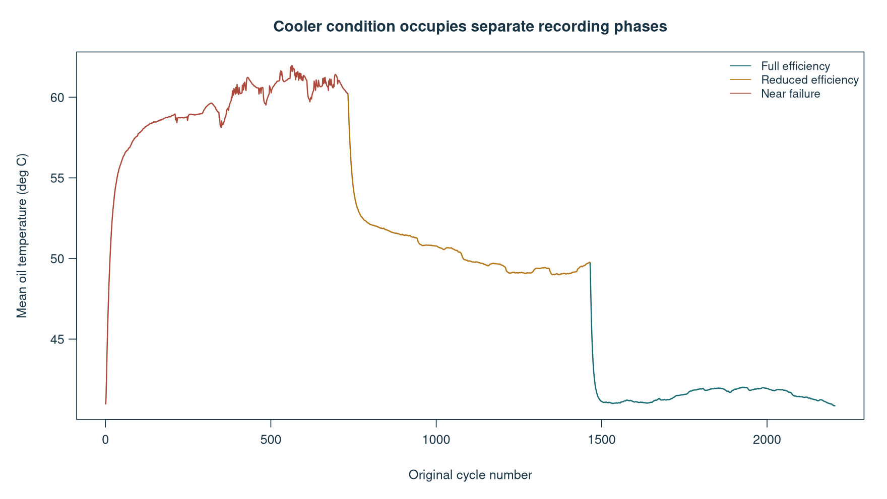

> Matching recorded settings does not remove unmeasured drift or create independent replications of cooler assignment.

## 4. Feature extraction and physical interpretation

Each diagnostic row represents one complete cycle. The six core features were selected by their physical roles before opening the final holdout: TS2 mean and slope, FS1 mean, PS2 standard deviation, EPS1 mean and VS1 mean. The full derived table also retains auxiliary summaries from every physical sensor.

Time is measured in seconds as sample index divided by the sampling frequency. The slope uses all within-cycle readings and has units degrees Celsius per second. Pressure standard deviation describes fluctuations within one cycle; it is distinct from covariance across cycle or matched-setting summaries.

The diagnostic scaler is fitted on development cycles only. A different, common global scale of the 144 matched profiles supports descriptive and inferential comparisons. These two scales have distinct purposes and are both exported.

$$
\bar{x}=\frac{1}{m}\sum_{j=1}^{m}x_j
$$

$$
s=\sqrt{\frac{\sum_j(x_j-\bar{x})^2}{m-1}}
$$

$$
\widehat b=\frac{\sum_j(t_j-\bar{t})(x_j-\bar{x})}{\sum_j(t_j-\bar{t})^2}
$$

| Feature | Unit | Role |
| --- | --- | --- |
| TS2_mean | deg C | Mean oil temperature |
| TS2_slope | deg C/s | Temperature trend |
| FS1_mean | L/min | Mean volume flow |
| PS2_std | bar | Pressure fluctuation |
| EPS1_mean | W | Mean motor power |
| VS1_mean | mm/s | Mean vibration |

## 5. Mean vectors

For each cooler condition, the mean vector gives the centre of its six-dimensional profile distribution across the 48 matched settings. The raw-unit table preserves physical interpretation, while the figure puts all coordinates on the same global standardized scale.

A mean difference alone does not describe uncertainty, covariance or prediction error. In particular, the large recorded temperature separation motivates a temperature-only baseline rather than attributing a perfect intact score to sensor fusion.

$$
\bar{\mathbf{x}}_k=\frac{1}{n_k}\sum_{s=1}^{n_k}\mathbf{x}_{sk},\qquad n_k=48
$$

| Coordinate | Full | Reduced | Near failure |
| --- | --- | --- | --- |
| Temperature | 41.643 | 49.723 | 60.186 |
| Temperature trend | 0.002590 | 0.004312 | 0.001397 |
| Flow | 6.529 | 6.489 | 4.919 |
| Pressure SD | 47.322 | 46.611 | 51.196 |
| Motor power | 2,552.380 | 2,471.899 | 2,504.401 |
| Vibration | 0.546 | 0.614 | 0.696 |

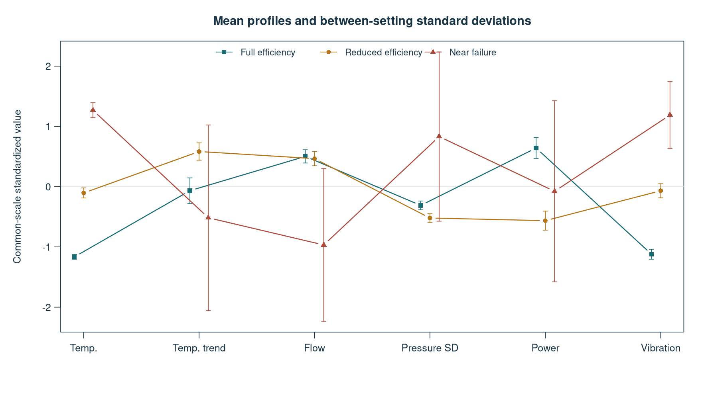

## 6. Covariance and correlation

The sample covariance matrix records both marginal variability and joint variation. A positive covariance indicates that two coordinates tend to be above their group means together, whereas a negative covariance indicates opposite deviations.

Correlation divides covariance by the corresponding standard deviations. It is dimensionless and lies between −1 and +1, but it measures linear association rather than a general form of independence.

The matrices below use the 48 matched profiles within each condition. Covariances use a common global scale. Correlations use their usual within-group variance normalization. The near-failure condition exhibits especially strong flow, pressure and power relationships.

$$
S_k=\frac{1}{n_k-1}\sum_s(\mathbf{x}_{sk}-\bar{\mathbf{x}}_k)(\mathbf{x}_{sk}-\bar{\mathbf{x}}_k)^\top
$$

$$
r_{ij}=\frac{s_{ij}}{\sqrt{s_{ii}s_{jj}}}
$$

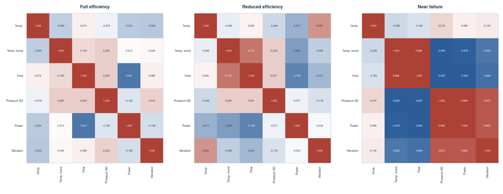

## 7. Generalized variance

Generalized variance is the determinant of the covariance matrix. It equals the product of its eigenvalues, combining spread along all principal directions. It decreases when coordinates are strongly redundant, even when some individual variances are large.

Because all groups use the same global coordinate transformation, determinant ratios compare their multivariate spread meaningfully. Scaling every group by its own standard deviations would instead compare determinants of correlation matrices.

The pth root returns a variance-scale summary. The log determinant is numerically stable and avoids loss of precision for small determinants. An ellipsoid volume is proportional to the square root of the determinant, with dimension and radius held fixed.

$$
GV_k=|S_k|=\prod_{j=1}^{p}\lambda_{jk},\qquad SGV_k=|S_k|^{1/p}
$$

$$
\log |S_k|=\sum_j\log\lambda_{jk}
$$

| Condition | log determinant | SGV |
| --- | --- | --- |
| Full efficiency | -29.98389 | 0.006756 |
| Reduced efficiency | -29.65843 | 0.007133 |
| Near failure | -19.15726 | 0.041054 |

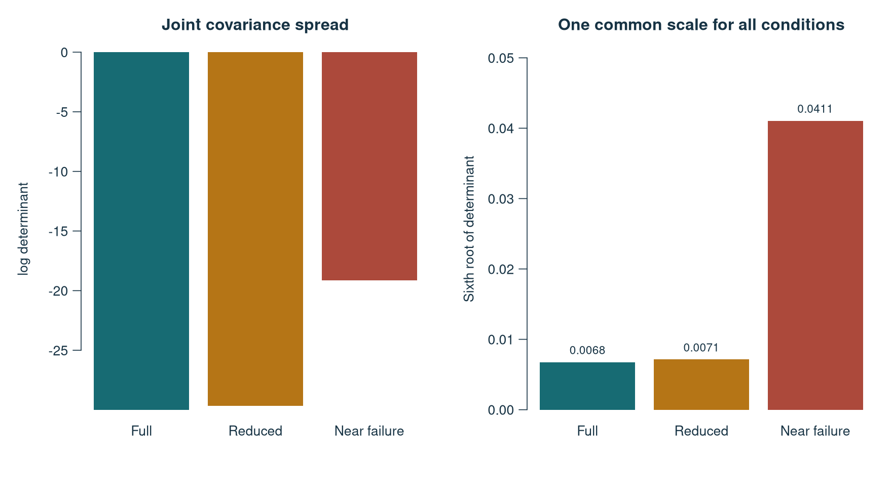

## 8. Skewness, kurtosis and Gaussianity

Normality checks are performed within cooler condition. Pooling conditions with separated means produces a mixture even if every conditional group were Gaussian. The original phase structure and nuisance variation also make normality a scientific question rather than a default assumption.

Marginal summaries include bias-corrected skewness, excess kurtosis and Shapiro references. Multivariate checks use Mardia skewness and kurtosis [5]. Their usual asymptotic references are supplemented with 999 independent Gaussian simulations at the actual n = 48 and p = 6.

Mardia statistics are affine-invariant. Therefore one simulated standard-normal reference can be reused across these equal-size, equal-dimensional groups. These simulations address finite sample size under the stated Gaussian iid model; they do not remove dependence across experimental settings.

$$
D_{ij}=(\mathbf{x}_i-\bar{\mathbf{x}})^\top\widehat\Sigma_{ML}^{-1}(\mathbf{x}_j-\bar{\mathbf{x}})
$$

$$
b_{1,p}=\frac{1}{n^2}\sum_{i,j}D_{ij}^3,\qquad b_{2,p}=\frac{1}{n}\sum_i D_{ii}^2
$$

| Condition | Skewness | Skew MC p | Kurtosis | Kurtosis MC p |
| --- | --- | --- | --- | --- |
| Full efficiency | 9.428 | 0.032 | 42.463 | 0.106 |
| Reduced efficiency | 8.180 | 0.106 | 43.579 | 0.280 |
| Near failure | 13.631 | 0.001 | 44.165 | 0.436 |

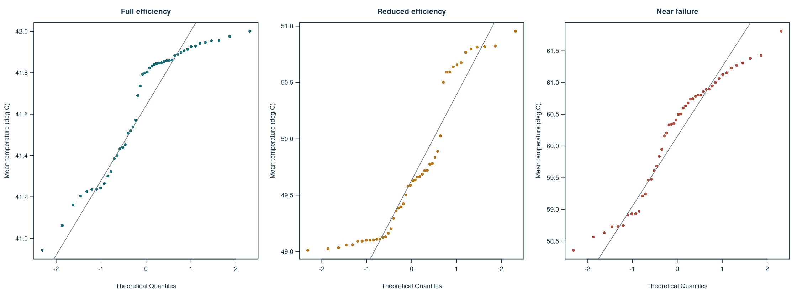

## 9. Interpreting distribution diagnostics

The Gaussian population kurtosis target is p(p+2) = 48 for p = 6. Finite-sample fitted distances are not exactly the population chi-square distribution. The multivariate Q-Q plots are diagnostics, while the finite-sample Mardia simulations provide the stated model-based reference.

Near-failure profile skewness is especially incompatible with the independent Gaussian reference. Full-efficiency skewness also shows a departure at the unadjusted 5% level. These checks are diagnostic, not a family of confirmatory claims selected after inspecting p-values.

We retain Gaussian models as transparent working approximations for estimation and diagnosis, label their inferential references, and evaluate prediction separately. Transformations, mixture models or copulas would require a new justified modelling question and validation; this project does not add them solely to increase method count.

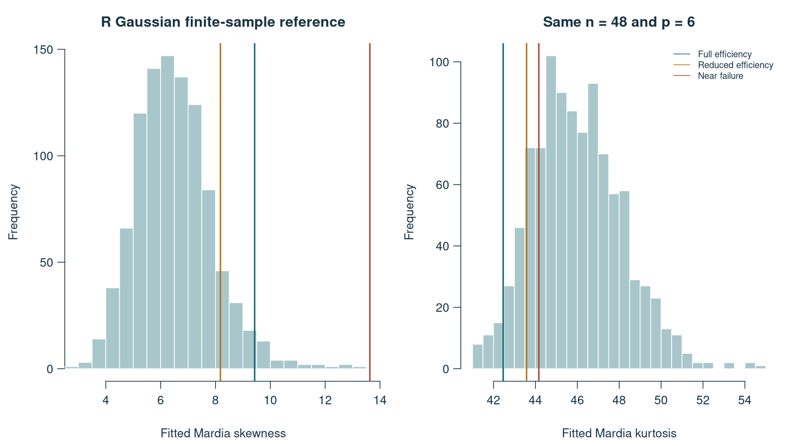

## 10. Maximum likelihood estimation

For independent multivariate-normal vectors, the Gaussian likelihood yields a closed-form mean and covariance. The maximum-likelihood covariance uses divisor n, while the unbiased sample covariance uses n−1. Keeping these conventions separate is necessary for the subsequent calculations.

The full six-coordinate analytical estimates describe each condition. An independent numerical optimization checks a two-coordinate full-efficiency example using temperature and power in the common standardized units.

The numerical parameters are means, log standard deviations and atanh(correlation). This parameterization guarantees positive standard deviations and correlation strictly within (−1,1), hence a positive-definite bivariate covariance.

$$
\ell=-\frac{np}{2}\log(2\pi)-\frac{n}{2}\log|\Sigma|-\frac{1}{2}\sum_i(\mathbf{x}_i-\mu)^\top\Sigma^{-1}(\mathbf{x}_i-\mu)
$$

$$
\widehat\mu_{ML}=\bar{\mathbf{x}},\qquad\widehat\Sigma_{ML}=\frac{n-1}{n}S
$$

| Check | Computed result |
| --- | --- |
| Analytical log likelihood | 106.431480003 |
| Numerical log likelihood | 106.431480003 |
| Maximum parameter gap | 3.012e-10 |
| Optimizer converged | True |

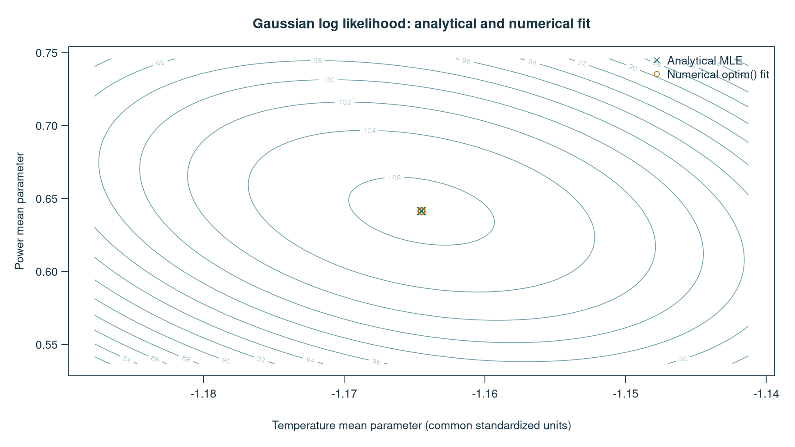

## 11. MANOVA with matched setting effects

The matched additive model gives every nuisance setting its own baseline and asks whether cooler/phase levels share the same mean profile. There are 144 observations, 48 setting intercept parameters and two condition contrasts, giving 94 residual degrees of freedom.

Residual SSCP matrices come from reduced and full models. Their difference is the hypothesis SSCP matrix. We solve the symmetric generalized eigenproblem instead of taking ordinary eigenvalues of a numerically nonsymmetric inverse product.

The handwritten-course connection is explicit: Roy uses the largest root, while Wilks uses all roots. The matrix calculations agree with stats::manova in R, using the same matched setting model [4].

The residual contains cooler-by-setting interaction and profile estimation noise, since there is only one aggregated profile per cell. The conventional references assume the fitted error model. Cooler and phase remain inseparable.

$$
\mathbf{Y}_{sk}=\alpha_s+\tau_k+\varepsilon_{sk},\qquad H_0:\tau_1=\tau_2=\tau_3
$$

$$
E=R_1^\top R_1,\qquad H=R_0^\top R_0-E,\qquad Hv=\lambda Ev
$$

$$
\Lambda=\prod_j(1+\lambda_j)^{-1},\qquad Roy=\max_j\lambda_j
$$

| Statistic | Value | Conventional iid p |
| --- | --- | --- |
| Wilks | 7.911e-04 | 4.468e-131 |
| Pillai | 1.796473 | 1.644e-82 |
| Hotelling-Lawley | 255.263837 | 1.192e-178 |
| Roy | 251.252891 | 8.868e-106 |

## 12. Simulation of the MANOVA reference

The observed Roy statistic is 251.2529. Its Gaussian iid null is generated around the reduced-model fitted means, with covariance estimated from the full residual and both models refitted in every replicate.

Two separate wild sensitivities apply one random sign to all three cooler rows and all six responses within a setting. The restricted version uses null-model residuals, following the restricted wild-bootstrap idea [7]. The full-residual version centres full-model residuals around the null fitted means and is labelled separately.

All three references place the observed statistic far in their upper tail. Their shared Monte Carlo p of 0.001 is the minimum resolution for 999 simulations. This is a statement under the specified null models, not a generally dependence-corrected or causal p-value.

$$
Y_s^*=\widehat Y_{0,s}+w_sR_s,\qquad w_s\in\{-1,+1\}
$$

$$
\widehat p=\frac{1+\sum_{b=1}^{B}I(T_b^*\geq T_{obs})}{B+1}
$$

| Reference | 95% simulated cutoff | MC p |
| --- | --- | --- |
| gaussian_iid_null | 0.19031 | 0.001 |
| wild_restricted | 0.24285 | 0.001 |
| wild_full_residual | 0.24501 | 0.001 |

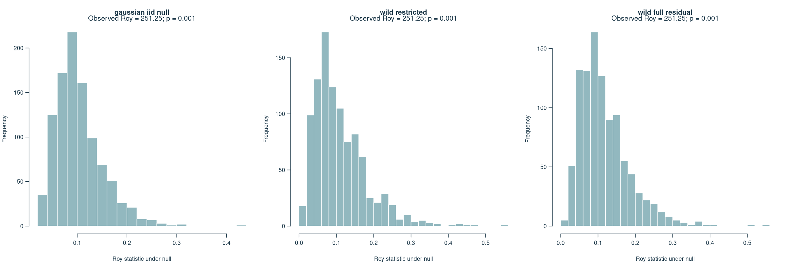

## 13. Paired Hotelling T-squared

For each planned condition pair, we subtract the two profiles recorded at the same nuisance setting. The 48 resulting difference vectors support a one-sample Hotelling test of a zero mean difference.

The F reference is exact under independent Gaussian differences. The three planned comparisons receive Holm correction. Sign-flip p-values are separately labelled sensitivities requiring appropriate symmetry/exchangeability.

Large T-squared values show that the measured differences are large relative to the between-setting difference covariance. They do not identify a causal cooler effect independently of recording phase.

$$
T^2=b\bar{\mathbf{d}}^{\top}S_d^{-1}\bar{\mathbf{d}},\qquad F=\frac{b-p}{p(b-1)}T^2\sim F_{p,b-p}
$$

$$
b=48,\quad p=6,\quad df_F=(6,42)
$$

| Difference | T-squared | iid p | Holm iid p |
| --- | --- | --- | --- |
| 20 minus 100 | 17,168.87 | 3.634e-52 | 7.268e-52 |
| 3 minus 100 | 29,407.02 | 4.611e-57 | 1.383e-56 |
| 3 minus 20 | 5,347.42 | 1.377e-41 | 1.377e-41 |

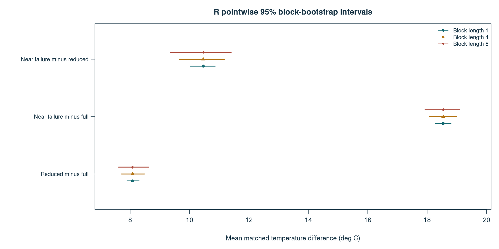

## 14. Mean confidence versus a new observation

A confidence ellipsoid describes uncertainty about a mean, whereas a prediction region describes an individual future vector. They have different radii. NIST explicitly warns against transferring mean-test limits directly to individual control-chart decisions [3].

For independent Gaussian observations with unbiased covariance S, the following mean and predictive cutoffs illustrate the distinction. The plotted ellipse is a projection of the six-dimensional mean-difference confidence region; its scatter points are individual matched differences.

The diagnostic prototype does not use a mean-test F cutoff as an individual alarm threshold. It compares fitted class densities and reports the corresponding conditional model probabilities.

$$
n(\bar{\mathbf{x}}-\mu)^\top S^{-1}(\bar{\mathbf{x}}-\mu)\leq\frac{p(n-1)}{n-p}F_{p,n-p;0.95}
$$

$$
(\mathbf{x}_{new}-\bar{\mathbf{x}})^\top S^{-1}(\mathbf{x}_{new}-\bar{\mathbf{x}})\leq\frac{p(n+1)(n-1)}{n(n-p)}F_{p,n-p;0.95}
$$

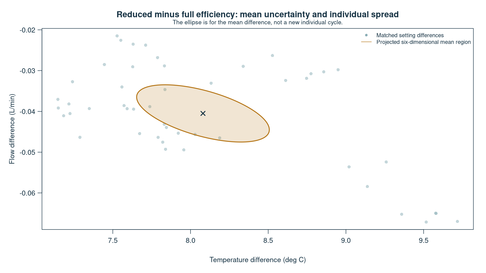

## 15. Covariance equality tests

Box M compares the condition covariance matrices using unbiased covariances and residual degrees-of-freedom weights. The first-order correction produces the conventional approximate chi-square reference with 42 degrees of freedom.

The Gaussian covariance likelihood-ratio test is a distinct calculation. It uses ML covariance divisors n_k and sample-size weights. Its likelihood difference is independently checked in the tests.

A matched Gaussian null additionally assumes a 50% shared normal component inside each setting. This is an explicit sensitivity scenario, not an estimate of the true cross-condition dependence. Its simulated p is 0.001.

All working references strongly challenge equality. This does not force the classifier to use a separate covariance for each class. Predictive utility is assessed on held-out settings.

$$
S_P=\frac{\sum_k(n_k-1)S_k}{N-g},\qquad M=(N-g)\log|S_P|-\sum_k(n_k-1)\log|S_k|
$$

$$
c=\frac{2p^2+3p-1}{6(p+1)(g-1)}\left(\sum_k\frac{1}{n_k-1}-\frac{1}{N-g}\right)
$$

$$
(1-c)M\ \dot\sim\ \chi^2_{(g-1)p(p+1)/2}
$$

| Quantity | Result |
| --- | --- |
| M | 732.272649 |
| Correction c | 0.060115 |
| Corrected chi-square | 688.252206 |
| df | 42 |
| Conventional iid p | 8.358e-118 |

## 16. Covariance simulation and interpretation

The matched Gaussian reference generates one common normal component per setting and three condition-specific normal components. Each contributes half of the pooled covariance. This retains an explicit positive relationship between the matched conditions while imposing equal marginal covariance.

The 50% fraction is assumed for sensitivity analysis. It is not fitted as the actual dependence of this experiment. The source has only one recording campaign for each cooler grade, so the simulation cannot reproduce or eliminate unmeasured phase drift.

The observed covariance contrast is far beyond this simulated null. The near-failure covariance also has a much larger overall scale. Nevertheless, a flexible covariance estimate can have higher estimation error, which is why covariance structure is selected by grouped predictive validation rather than by a hypothesis test alone.

| Additional calculation | Result |
| --- | --- |
| Gaussian ML covariance LR | 747.852919 |
| LR conventional iid p | 5.003e-130 |
| Matched Gaussian Monte Carlo p | 0.001 |

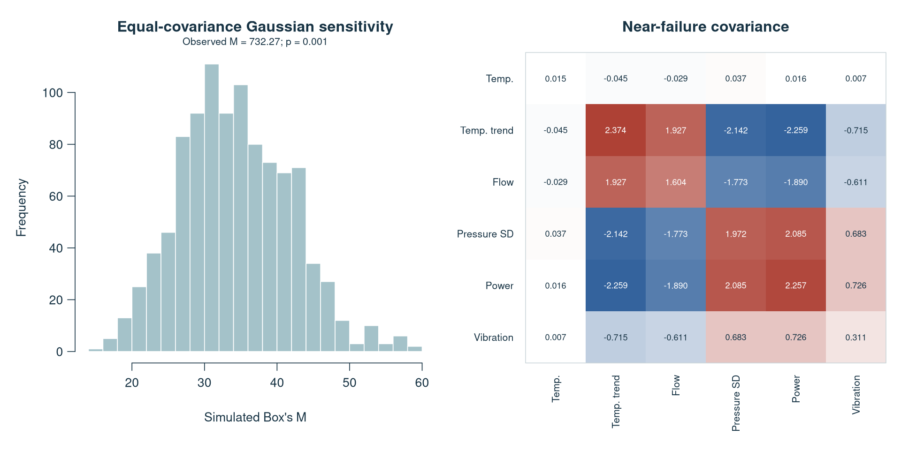

## 17. Partial correlation and explanatory regression

Raw correlations can combine within-condition relationships with differences between conditions. We regress every profile coordinate on additive categorical cooler/phase, valve, pump and accumulator factors, then correlate the residual columns.

This produces a partial-correlation description after the specified adjustment. It is an association analysis. It neither resolves cooler/phase confounding nor makes the residuals automatically independent.

The corresponding explanatory temperature regression has in-sample R-squared 0.992847. This number is explicitly not cross-validated diagnostic accuracy. The true component labels are used for interpretation here, never as inputs to the diagnostic prototype.

$$
\widehat B=(X^\top X)^{-1}X^\top Y,\qquad R=Y-X\widehat B
$$

$$
r_{ij\,\cdot\,X}=\mathrm{Corr}(R_i,R_j),\qquad R^2=1-\frac{\sum_i(y_i-\widehat y_i)^2}{\sum_i(y_i-\bar y)^2}
$$

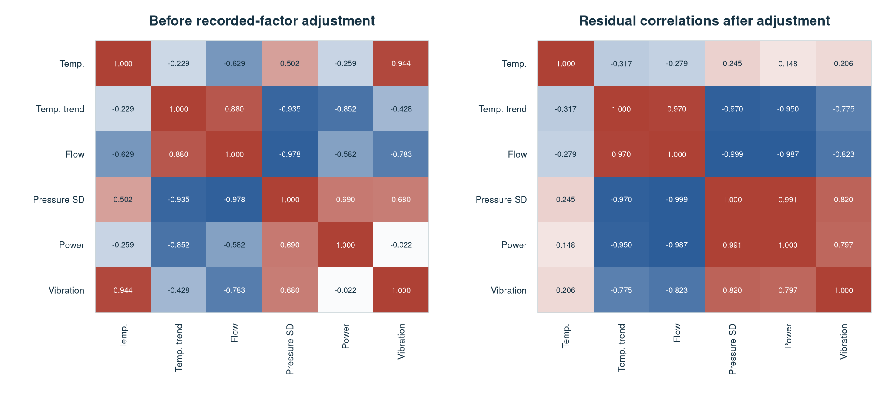

## 18. Diagnostic Gaussian models and selection

The final diagnostic application compares class densities for standardized cycle summaries. The temperature-only baseline uses TS2 mean. The other candidates use all six features with diagonal, shared or class-specific covariance.

Every mean, covariance, prior and diagnostic scaling parameter is fitted solely on development cycles. The six-fold grouped cross-validation excludes complete nuisance settings. Its prespecified objective is the average log loss across intact data and complete TS2 outage, with equal weights.

For each covariance family, alpha is chosen from 0, 0.0001, 0.001, 0.01, 0.05 and 0.1. Positive alpha shrinks covariance toward a trace-scaled identity and represents regularized Gaussian estimation, not unrestricted MLE.

The selected family is shared covariance with alpha = 0. The frozen specification is saved before final holdout metrics are computed. The shared covariance uses the ML pooled scatter divided by the total development sample size.

$$
\log q_k(\mathbf{z})=\log\pi_k-\frac{1}{2}\left[p\log(2\pi)+\log|\Sigma_k|+(\mathbf{z}-\mu_k)^\top\Sigma_k^{-1}(\mathbf{z}-\mu_k)\right]
$$

$$
P(k\mid\mathbf{z})=\frac{\exp(\log q_k)}{\sum_j\exp(\log q_j)}
$$

$$
\Sigma_{\alpha}=(1-\alpha)\widehat\Sigma+\alpha\frac{\mathrm{tr}(\widehat\Sigma)}{p}I
$$

> Model probability is conditional on the Gaussian working model and observed experiment. It is not guaranteed physical confidence.

## 19. Held-out evaluation

The final evaluation contains 360 stable cycles from twelve nuisance settings that are absent from training under every cooler condition. Each condition contributes 120 cycles. This tests new recorded settings within the same rig and phases, not future machines.

All four models classify intact stable cycles correctly. Accordingly, no incremental intact-data accuracy is claimed for the joint model. Its relevant added value is the prespecified sensor-outage case.

Balanced accuracy averages recall across the three conditions. The project also reports ordinary accuracy, macro F1, confusion matrices, multiclass Brier score, log loss, healthy false alarms and near-failure cycles incorrectly called healthy.

$$
\mathrm{Balanced\ accuracy}=\frac{1}{3}\sum_{k=1}^{3}\frac{TP_k}{TP_k+FN_k}
$$

$$
\mathrm{LogLoss}=-\frac{1}{N}\sum_i\log P(y_i\mid\mathbf{x}_i)
$$

| Model | Intact balanced accuracy | TS2 outage balanced accuracy |
| --- | --- | --- |
| temperature | 100.00% | 33.33% |
| diagonal | 100.00% | 99.44% |
| shared | 100.00% | 100.00% |
| full | 100.00% | 99.72% |

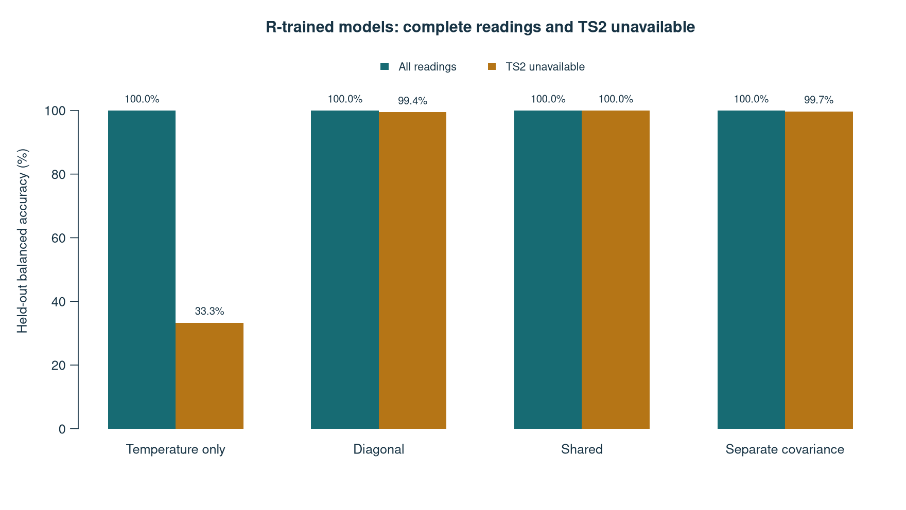

## 20. Sensor outage through Gaussian marginalization

A TS2 outage removes both its mean and slope coordinates. The joint model evaluates the Gaussian marginal of the four available coordinates. It uses the corresponding mean entries and covariance submatrix, rather than filling missing measurements with arbitrary values.

When the temperature-only model loses TS2, no model coordinates remain. Its scores reduce to log class priors, and its most frequent-class prediction has balanced accuracy 33.33%. The selected joint model retains 100% balanced accuracy on the observed stable holdout.

The result establishes a useful fallback under this defined simulation. It does not quantify actual field sensor-failure rates, remaining lifetime or performance on a different rig.

$$
\mathbf{z}_O\mid k\sim N(\mu_{k,O},\Sigma_{k,OO})
$$

$$
\log q_k(\mathbf{z}_O)=\log\pi_k+\log\phi_{p_O}(\mathbf{z}_O;\mu_{k,O},\Sigma_{k,OO})
$$

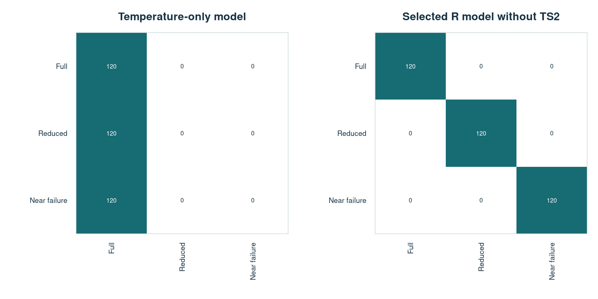

## 21. Resampling uncertainty and its limits

Whole matched settings are the resampling units for inferential mean-difference intervals. Circular block lengths 1, 4 and 8 are sensitivity analyses using settings ordered by first occurrence. The longer blocks preserve adjacent ordering in that constructed sequence; they do not establish independent cooler replicates or remove drift confounding.

Diagnostic uncertainty resamples the twelve held-out settings, keeping all their condition cycles together. For a perfect observed holdout, the percentile bootstrap interval is [100%,100%]. This is degenerate because resampling cannot create errors absent from every observed setting.

A perfect empirical bootstrap interval does not prove perfect future performance. Under an additional independent representative-setting assumption, zero failed settings out of twelve still permits a one-sided 95% upper probability of a future failed setting of about 22.1%. That is a different estimand from cycle balanced accuracy and is not asserted without its assumption.

All Monte Carlo p-values use the plus-one correction. No simulated test reports p = 0. The model and resampling seeds are fixed and exported for reproduction.

$$
\widehat p=\frac{1+\#\{T_b^*\geq T_{obs}\}}{B+1}
$$

$$
u_{0.95}=1-0.05^{1/12}\approx0.221
$$

> The second expression is a setting-failure probability bound under an extra independent-setting model, not an interval for balanced accuracy.

## 22. Transition and calibration-bias sensitivity

The held-out nuisance settings also contain 266 cycles flagged as possibly not stationary. They were never used for model selection. They form a separate transition stress subset, not part of the primary stable score.

On this subset, the selected model has ordinary accuracy 87.22% and balanced accuracy 94.89%. The class imbalance explains why these two summaries differ. Some near-failure cycles are confused with other conditions during transitions.

A second simulation adds offsets of −8, −4, 0, +4 and +8 degrees Celsius to TS2 mean only. The within-cycle slope and recorded physical state remain unchanged. This is a simulated sensor calibration bias, not a physical process-temperature intervention.

| Recorded class | Predicted full | Predicted reduced | Predicted near failure |
| --- | --- | --- | --- |
| Full efficiency | 22 | 0 | 0 |
| Reduced efficiency | 0 | 22 | 0 |
| Near failure | 6 | 28 | 188 |

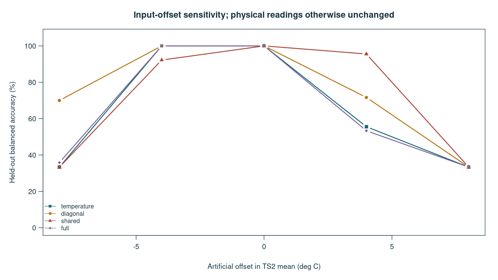

## 23. Interactive prototype and presentation walkthrough

Open START_HERE.html after extracting the complete ZIP. The offline prototype uses local scripts, fonts, data and figures. The bundled presentation opens offline. Open Hydraulic_Cooler_Statistics.Rproj in RStudio to run the statistical analysis. External reference links remain optional.

The prototype contains fourteen slides for a 20–30 minute presentation. Each required statistical method connects a short explanation to computed results and visual evidence. Present mode hides navigation and supports left/right arrow keys; Escape returns to the normal view.

On slide 13, choose a measured near-failure example from the Recorded example selector. This example comes from a held-out setting. Compare its model output with the recorded label. Disable the TS2 sensor to see the four-coordinate Gaussian marginal. Then select the temperature-only baseline and explain why the output becomes the class prior.

Change a sensor value to create a manual scenario and inspect the log-prior, log-determinant, squared-distance and log-score terms. Manual scenarios are clearly distinguished from measured cycles, and the model-probability limitation remains visible.

| Presentation segment | Suggested time |
| --- | --- |
| Question, source and design limitation | 3 minutes |
| Mean, covariance and generalized variance | 5 minutes |
| Distribution checks and MLE | 4 minutes |
| MANOVA, Hotelling and covariance equality | 5 minutes |
| Partial relationships and model testing | 5 minutes |
| Live model demonstration | 4 minutes |
| Conclusion | 1 minute |

## 24. Limitations and defensible conclusions

Cooler condition is perfectly aligned with recording phase. Consequently, no test or matching procedure in this dataset identifies a causal cooler effect separately from unmeasured long-term drift.

The 48 nuisance settings were experimentally configured rather than sampled as independent machines. Setting independence, symmetry, exchangeability and the assumed Gaussian nulls must remain attached to the corresponding inferential references. The block calculations are sensitivity analyses, not a universal correction.

Normality is imperfect, covariances differ, and cycle readings are serially continuous. The matched additive model and held-out-setting protocol reduce specific weaknesses but cannot establish fleet-wide validity. Large sample counts within a configuration are not independent cooler-assignment replications.

The intact diagnostic task is easy for temperature. The report therefore claims no multivariate improvement in that scenario. The observed contribution is the successfully tested fallback under complete TS2 removal, alongside an explicit explanation of mean and covariance patterns.

The project is an analytical and diagnostic prototype for current condition on this experiment. Remaining-life forecasts, guaranteed physical confidence and deployment on different machines require additional evidence.

> A scientifically strong conclusion states what the evidence supports and where the experiment leaves ambiguity.

## 25. R implementation and reproduction

We used R for data preparation, all statistical calculations, simulations, model training and prediction. The two required packages are jsonlite and digest. RStudio provides the editor used to run and inspect the code.

The main workflow reads the original sensor archive and saves the six cycle features. It uses colMeans, cov and cor for summaries; our R functions implement Hotelling T-squared, Box M and the Gaussian classifier. The MANOVA calculation is checked with R stats::manova.

In R/Presentation_Demo.R, the calculations follow the slides in order. Run one section at a time to show the numerical output. The model is fitted using training settings only, then tested on the separate settings.

The slides use the R simulation results and R-trained parameters. JavaScript displays the plots and scores edited readings using that saved model. The R source files perform the statistics and model fitting.

| Task | R command or file |
| --- | --- |
| Run the full analysis | source("run_project.R") |
| Follow the slides | R/Presentation_Demo.R |
| Check statistical calculations | R/tests/run_tests.R |
| Inspect the trained model | R/models/trained_gaussian_model.rds |
| Read computed results | R/results/R_Analysis_Report.html |
| Predict a CSV | R/predict.R |

## 26. References

[1] Helwig, N., Pignanelli, E. and Schuetze, A. Condition monitoring of hydraulic systems. UCI Machine Learning Repository. DOI: 10.24432/C5CW21. https://archive.ics.uci.edu/dataset/447/condition+monitoring+of+hydraulic+systems

[2] Helwig, N., Pignanelli, E. and Schuetze, A. (2015). Condition Monitoring of a Complex Hydraulic System Using Multivariate Statistics. IEEE I2MTC. DOI: 10.1109/I2MTC.2015.7151267. Original study and setup context.

[3] NIST/SEMATECH e-Handbook of Statistical Methods, section 6.5.4.3. Hotelling T-squared. https://www.itl.nist.gov/div898/handbook/pmc/section5/pmc543.htm

[4] R stats documentation. summary.manova. MANOVA statistics and Roy approximation convention. https://stat.ethz.ch/R-manual/R-devel/library/stats/html/summary.manova.html

[5] Mardia, K. V. (1970). Measures of multivariate skewness and kurtosis with applications. Biometrika, 57(3), 519–530. DOI: 10.1093/biomet/57.3.519.

[6] R stats documentation. optim: numerical optimization used to check the Gaussian maximum-likelihood estimates. https://stat.ethz.ch/R-manual/R-patched/library/stats/html/optim.html

[7] Cameron, A. C., Gelbach, J. B. and Miller, D. L. Bootstrap-based improvements for inference with clustered errors. NBER Technical Working Paper 344. https://www.nber.org/papers/t0344

[8] R stats documentation. cov, cor and p.adjust: covariance, correlation and multiple-comparison adjustment. https://stat.ethz.ch/R-manual/R-patched/library/stats/html/cor.html

All figures are computations generated by this project from the credited UCI source. No illustrative values are presented as measured results. Local Plotly.js and KaTeX distributions retain their third-party licenses in the project.
